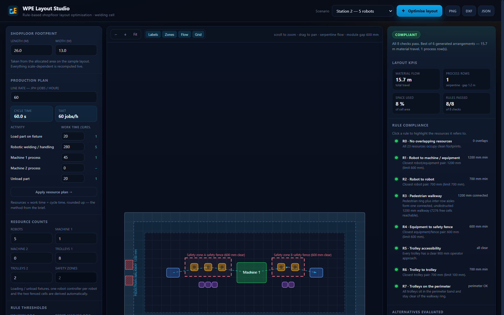

# WPE Layout Studio

Rule-based shopfloor layout optimisation for welded-parts engineering (WPE) cells.

Built from the hackathon problem statement *WPE_Layout Optimization*: given a fixed shopfloor area, a line rate (JPH)
and a list of resources, generate a shopfloor arrangement that satisfies every clearance rule and keeps material
travel short — instead of iterating manually.



**Live app:** enable GitHub Pages for this repository (see [Deploy](#deploy)) or open `index.html` directly — there is
no build step, no backend and no external dependency.

---

## What it does

1. **Resource planning from the line rate.** `cycle time = 3600 ÷ JPH`, `resources ≈ work time ÷ cycle time`
   (rounded up). 60 JPH → 60 s takt; 150 s of robot work → 3 robots; 280 s → 5 robots. The counts in the deck
   (3 robots for Station 1, 5 for Station 2) are reproduced by the model.
2. **Module generation.** Loading fixture → fenced robot cell → Machine 1 → Machine 2 → fenced robot cell →
   unload fixture. Each fenced cell carries its own controllers *outside* the fence, so the 600 mm
   equipment-to-fence rule is satisfied by construction, not by luck.
3. **Layout search.** Modules are packed into serpentine rows over a sweep of row gaps, module gaps and flow
   directions. Every candidate is a real, complete layout — not a sketch.
4. **Rule verification.** The engine recomputes all clearances from the produced geometry and flood-fills a raster of
   the hall to prove the walkway is continuous. A layout only wins if it passes all eight checks.
5. **Delivery.** Canvas visualisation with hover inspection, plus PNG, DXF (R12, mm) and JSON exports and a CSV BOM.

## The rules enforced

| ID | Rule |
|----|------|
| R0 | No overlapping resources |
| R1 | ≥ 800 mm between a robot and any machine / equipment |
| R2 | ≥ 700 mm between two robots |
| R3 | Continuous, unobstructed pedestrian walkway (≥ 1200 mm, ring plus inter-row aisles) |
| R4 | ≥ 600 mm between any resource / equipment and the safety fence |
| R5 | Every material trolley has a clear ≥ 900 mm operator approach |
| R6 | ≥ 100 mm between adjacent material storage trolleys |
| R7 | Trolleys only in the perimeter band, clear of the walkway and of production resources |

All thresholds are editable in the UI; the engine and the report use the same numbers you set.

## Screens

- **Shopfloor footprint** — hall length × width, straight from the allocated area on the sample drawing.
- **Production plan** — JPH, cycle time, per-activity work times and the derived resource count.
- **Resource counts** — robots, machines, trolleys; fixtures, controllers and the two safety zones are derived.
- **Stage** — canvas plan with zones, walkway, fences, material-flow arrows, zoom / pan / hover and toggles.
- **Results** — verdict, KPIs (material flow, rows, space used, rules passed), per-rule compliance with click-to-
  highlight, the list of alternatives evaluated, and diagnostics.

## Run it

No installation needed:

```bash
# just open it
start index.html            # Windows
open  index.html            # macOS
xdg-open index.html         # Linux
```

Or serve it (any static server works):

```bash
python -m http.server 8080   # then visit http://localhost:8080
```

## Verify it

The geometry engine is shared between the browser and Node, so the same code that draws the plan is the code under
test:

```bash
node tests/run.js        # engine: 3 presets, JPH maths, negative tests, 60-combination sweep
node tests/dom-check.js  # every element the UI touches exists, every script/style resolves
```

`tests/run.js` asserts that the featured stations and a 5 × 4 × 3 sweep of hall sizes / robot counts all produce
layouts that pass all eight rules.

## Export formats

| File | Contents |
|------|----------|
| `.png` | Current canvas view |
| `.dxf` | R12 DXF in millimetres, layers `HALL`, `WALKWAY`, `FENCE`, `ROBOT`, `MACHINE`, `FIXTURE`, `CONTROLLER`, `TROLLEY`, `FLOW`, `TEXT` — opens in AutoCAD / DraftSight / LibreCAD / any DWG tool |
| `.json` | Inputs, KPIs, per-rule compliance, alternatives evaluated and full geometry |
| BOM (via JSON) | Per-resource position, footprint and area |

## Project structure

```
index.html                 app shell + explainer
assets/css/style.css       dark industrial theme, responsive down to phones
assets/js/config.js        resource catalogue, rule thresholds, presets, JPH maths
assets/js/geometry.js      rectangle maths, raster + flood fill
assets/js/planner.js       module builder, row packer, perimeter trolley placement, search
assets/js/checker.js       the eight rule checks, recomputed from geometry
assets/js/renderer.js      canvas renderer (mm → px), pan / zoom / hit-test
assets/js/exporters.js     DXF / JSON / CSV / PNG writers
assets/js/app.js           DOM wiring
tests/run.js               headless engine assertions
tests/dom-check.js         static wiring assertions
```

## Assumptions

The brief fixes the rules and the resource counts but not the equipment footprints or the hall size, so both are
explicit inputs:

- Hall defaults to 24 × 13 m (Station 1) / 26 × 13 m (Station 2) — change the two fields to match the allocated area
  on the sample layout. The original brief, problem statement deck and sample DWG are kept in `docs/source/`.
- Footprints: loading / unload fixture 1400 × 1000, robot 800 × 800, controller 600 × 600, Machine 1 3200 × 2200,
  Machine 2 2600 × 2000, trolleys 1200 × 800 and 1000 × 800.
- 1000 mm perimeter band for material storage, 1200 mm pedestrian ring inside it, and a fenced robot cell whose fence
  is offset 600 mm from the robot envelope.

Swap the numbers in `assets/js/config.js` if your real equipment differs.

## Deploy

The repository ships with a GitHub Pages workflow (`.github/workflows/deploy.yml`): enable
**Settings → Pages → Source: GitHub Actions** and every push to `main` publishes the site.

## License

MIT — see [LICENSE](LICENSE).
