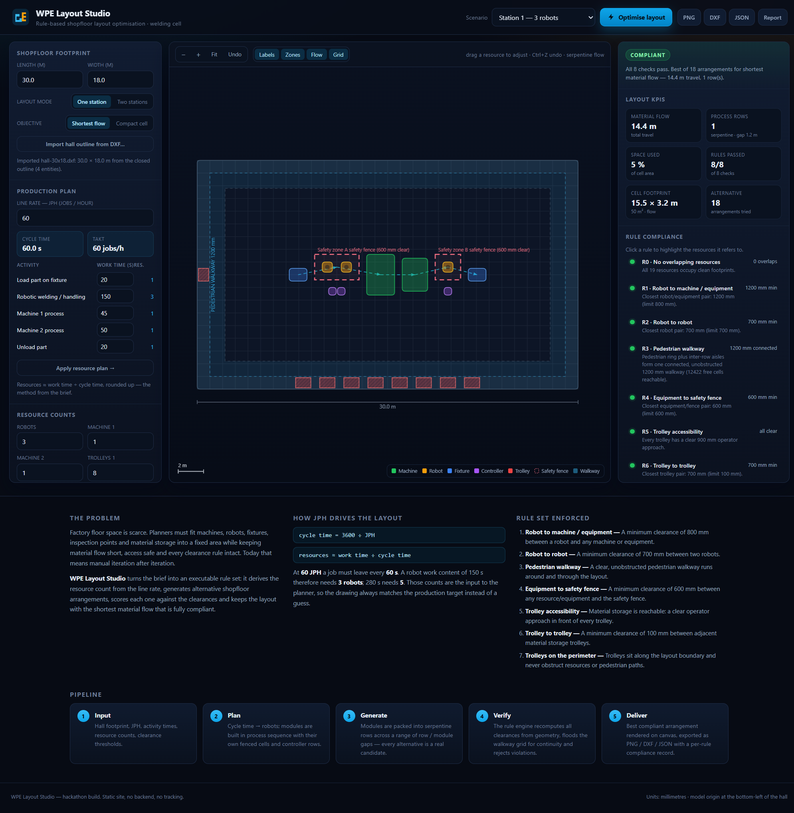
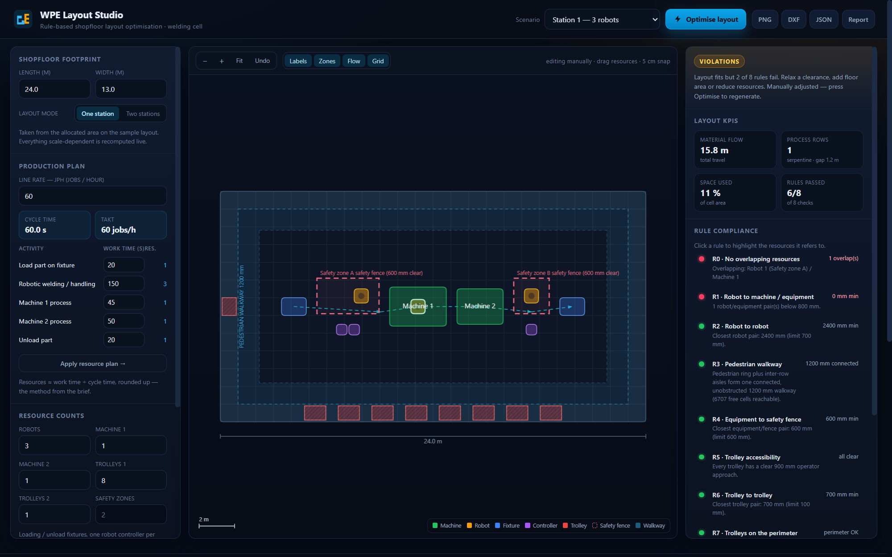
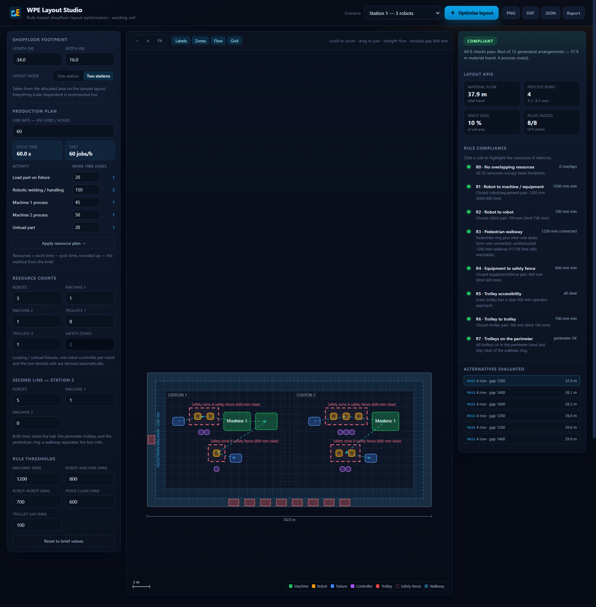

# WPE Layout Studio

Rule-based shopfloor layout optimisation for welded-parts engineering (WPE) cells.

Built from the hackathon problem statement *WPE_Layout Optimization*: given a fixed shopfloor area, a line rate (JPH)
and a list of resources, generate a shopfloor arrangement that satisfies every clearance rule and keeps material
travel short — instead of iterating manually.


**Pipeline flowchart:** [docs/pipeline.svg](docs/pipeline.svg)  ·  **Team quick reference (2 pages):** [docs/WPE-Layout-Studio-quick-reference.pdf](docs/WPE-Layout-Studio-quick-reference.pdf)

**Live app:** enable GitHub Pages for this repository (see [Deploy](#deploy)) or open `index.html` directly — there is
no build step, no backend and no external dependency.

---

## What it does

1. **Resource planning from the line rate.** `cycle time = 3600 ÷ JPH`, `resources ≈ work time ÷ cycle time`
   (rounded up). 60 JPH → 60 s takt; 150 s of robot work → 3 robots; 280 s → 5 robots. The counts in the deck
   (3 robots for Station 1, 5 for Station 2) are reproduced by the model.
2. **Module generation.** Loading fixture → fenced robot cell → Machine 1 → Machine 2 → fenced robot cell →
   unload fixture. Each fenced cell carries its own controllers *outside* the fence, so the 600 mm
   equipment-to-fence rule is satisfied by construction, not by luck.
3. **Layout search.** Modules are packed into rows over a sweep of row-width caps, row and module gaps, flow directions
   and machine orientation — 30 to 50 complete candidates per run, not a sketch. The winner is picked by a stated
   objective: **shortest material flow** or **smallest footprint**, which diverge as soon as floor area is scarce
   (e.g. 21.2 m travel in 94 m² vs 22.7 m in 74 m² on an 18 × 13 m hall).
4. **Rule verification.** The engine recomputes all clearances from the produced geometry and flood-fills a raster of
   the hall to prove the walkway is continuous. A layout only wins if it passes all eight checks.
5. **Delivery.** Canvas visualisation with hover inspection, plus PNG, DXF (R12, mm), JSON, CSV and a printable HTML
   report.
6. **Manual adjustment.** Any resource can be dragged on the plan (5 cm snap) and the rule engine re-checks the whole
   layout on every move — the compliance panel and the walkway flood-fill update live, so a what-if nudge immediately
   shows the rule it breaks. Undo with the toolbar button or Ctrl+Z.

## The rules enforced

| ID | Rule |
|----|------|
| R0 | No overlapping resources |
| R1 | ≥ 800 mm between a robot and any machine / equipment |
| R2 | ≥ 700 mm between two robots |
| R3 | Continuous, unobstructed pedestrian walkway (≥ 1200 mm, ring plus inter-row aisles) |
| R4 | ≥ 600 mm between any resource / equipment and the safety fence |
| R5 | Every material trolley has a clear ≥ 900 mm operator approach |
| R6 | ≥ 100 mm between adjacent material storage trolleys |
| R7 | Trolleys only in the perimeter band, clear of the walkway and of production resources |

All thresholds are editable in the UI; the engine and the report use the same numbers you set.

## Read the footprint off the drawing

The brief ships a DWG; the app reads **DXF** directly (export the DWG as DXF R12 or later — every CAD tool does it).
`assets/js/importer.js` parses `LINE`, `LWPOLYLINE`, old-style `POLYLINE`/`VERTEX`, `CIRCLE` and `ARC`, honours
`$INSUNITS` (mm, cm, m, inches, feet) and picks the largest closed outline as the hall; if there is no closed outline it
falls back to the drawing extents. One click sets the footprint and the layout re-solves.



## Adjust by hand, checked by machine

The generated plan is a starting point, not a straitjacket. Drag any robot, machine, fixture, controller or trolley and
the rule engine re-evaluates the whole layout on the way — the verdict, the KPI strip and every rule row update while
the pointer is still moving, and the walkway flood-fill runs again. The example below is a robot dropped onto Machine 1:
R1 collapses to 0 mm, R0 reports the overlap, the badge drops to 6/8 — then Ctrl+Z puts it back.



## Two layouts

The brief allocates one area for **two stations**, so the planner runs in two modes:

- **One station** — a single process chain (loading → fenced robot cell → machines → fenced robot cell → unload).
- **Two stations** — Station 1 and Station 2 side by side, each with its own chain, cells and controllers, separated by
  a walkway, sharing the hall, the pedestrian ring and the perimeter trolleys. All eight rules are re-checked across
  both lines, including the clearance between them.

Switching to two stations widens the footprint to 34 × 16 m (a single cell cannot hold both chains) and restores the
previous footprint when you switch back.



## Screens

- **Shopfloor footprint** — hall length × width, straight from the allocated area on the sample drawing, plus the
  layout mode (one / two stations) and the objective (shortest flow / compact cell).
- **Production plan** — JPH, cycle time, per-activity work times and the derived resource count.
- **Resource counts** — robots, machines, trolleys; fixtures, controllers and the two safety zones are derived.
- **Stage** — canvas plan with zones, walkway, fences, material-flow arrows, zoom / pan / hover, drag-to-adjust with
  live rule checking, and layer toggles.
- **Results** — verdict, KPIs (material flow, rows, space used, rules passed), per-rule compliance with click-to-
  highlight, the list of alternatives evaluated, and diagnostics.

## Run it

No installation needed:

```bash
# just open it
start index.html            # Windows
open  index.html            # macOS
xdg-open index.html         # Linux
```

Or serve it (any static server works):

```bash
python -m http.server 8080   # then visit http://localhost:8080
```

## Verify it

The geometry engine is shared between the browser and Node, so the same code that draws the plan is the code under
test:

```bash
node tests/run.js           # engine: presets, JPH maths, negative tests, objectives, 60-hall sweep
node tests/render-smoke.js  # real canvas code against a stub context + DXF/JSON/CSV/report output
node tests/import-test.js   # DXF reader fixtures: mm, inches, R12, bad input
node tests/dom-check.js     # every element the UI touches exists, every script/style resolves

# DXF sanity check against a real CAD parser (optional, needs python + ezdxf)
node tests/export-dxf.js && python tests/validate_dxf.py
```

`tests/run.js` asserts that the featured stations and a 5 × 4 × 3 sweep of hall sizes / robot counts all produce
layouts that pass all eight rules. The DXF produced for Station 1 opens in ezdxf as a valid R12 drawing in
millimetres, with the ten expected layers, the full 24 × 13 m extent and zero audit errors.

## Export formats

| File | Contents |
|------|----------|
| `.png` | Current canvas view |
| `.dxf` | R12 DXF in millimetres, layers `HALL`, `WALKWAY`, `FENCE`, `ROBOT`, `MACHINE`, `FIXTURE`, `CONTROLLER`, `TROLLEY`, `FLOW`, `TEXT` — opens in AutoCAD / DraftSight / LibreCAD / any DWG tool |
| `.json` | Inputs, KPIs, per-rule compliance, alternatives evaluated and full geometry |
| `.html` | Self-contained report: plan image, KPIs, per-rule compliance, full resource table and assumptions — printable to PDF from any browser |
| BOM (via JSON/CSV) | Per-resource position, footprint and area |

## Project structure

```
index.html                 app shell + explainer
assets/css/style.css       dark industrial theme, responsive down to phones
assets/js/config.js        resource catalogue, rule thresholds, presets, JPH maths
assets/js/geometry.js      rectangle maths, raster + flood fill
assets/js/planner.js       module builder, row packer, perimeter trolley placement, search
assets/js/checker.js       the eight rule checks, recomputed from geometry
assets/js/importer.js      DXF reader (units, closed outline, legacy POLYLINE)
assets/js/renderer.js      canvas renderer (mm → px), pan / zoom / hit-test
assets/js/exporters.js     DXF / JSON / CSV / PNG writers
assets/js/app.js           DOM wiring
tests/run.js               headless engine assertions
tests/render-smoke.js      renderer + exporter assertions
tests/import-test.js       DXF import: mm, inch, R12 vertex stream, bad input
tests/dom-check.js         static wiring assertions
tests/export-dxf.js        writes a DXF sample for the CAD validator
tests/validate_dxf.py      ezdxf validation of that DXF (optional tool)
```

## Assumptions

The brief fixes the rules and the resource counts but not the equipment footprints or the hall size, so both are
explicit inputs:

- Hall defaults to 24 × 13 m (Station 1) / 26 × 13 m (Station 2) — change the two fields to match the allocated area
  on the sample layout. The original brief, problem statement deck and sample DWG are kept in `docs/source/`.
- Footprints: loading / unload fixture 1400 × 1000, robot 800 × 800, controller 600 × 600, Machine 1 3200 × 2200,
  Machine 2 2600 × 2000, trolleys 1200 × 800 and 1000 × 800.
- 1000 mm perimeter band for material storage, 1200 mm pedestrian ring inside it, and a fenced robot cell whose fence
  is offset 600 mm from the robot envelope.

Swap the numbers in `assets/js/config.js` if your real equipment differs.

## Deploy

The repository ships with a GitHub Pages workflow (`.github/workflows/deploy.yml`): enable
**Settings → Pages → Source: GitHub Actions** and every push to `main` publishes the site.

## License

MIT — see [LICENSE](LICENSE).
